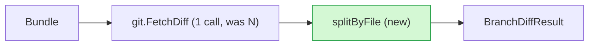

# PR Review

Review open pull requests using deterministic review bundles generated by `agents pr-review` in
`./.agents/local/pr-reviews/[number]-short-title/`.

## Steps

1. **Generate bundle**: Run `agents pr-review`. Done when: bundle path `<review_dir>/review.md` confirmed
   (`./.agents/local/pr-reviews/[number]-short-title/review.md`). Gather PR context via the bundle; use `gh` only for
   secondary context missing from the bundle.

2. **Inspect bundle**: Read `<review_dir>/review.md` following [Bundle Inspection](#bundle-inspection). Done when: CI
   status verified, high-risk files inspected via Table of Contents line ranges, diff dumps checked, unresolved threads
   evaluated, and external symbol usages reviewed.

3. **Check stack context**: If part of a stack (see `## Stack` in bundle):
   - Verify layer boundary: foundational types, database schemas, and shared models belong downstack; UI, API endpoints,
     and consumer glue belong upstack.
   - Check if interface or schema changes break upstack branches.
   - Check rebase status: alert user if `Warning: Branch needs rebase` is present. If diff is large and non-stacked,
     suggest splitting with the `stack-pr` skill. Done when: stack boundaries verified or split suggested.

4. **Review code**: Apply every rule in the `coding-standards` skill
   [Reviewing] in priority order (Correctness, Architecture/Design, Tests, Performance, Naming). Done when: every
   changed file checked against each rule with findings ranked.

5. **Classify comments**: Classify each unresolved thread as `question`, `misunderstanding`, or `suggestion`. Formulate
   concrete code fixes or draft replies. Done when: every unresolved thread has a planned resolution.

6. **Output review plan**: Render review plan in chat following [Review Plan Format](#review-plan-format). Done when:
   plan presented with stack context, change intent, positive/negative findings, and comment resolutions.

7. **Approval gate**: Stop and await user approval before editing code or making commits.

8. **Execute and update**: After user approval:
   - Apply approved code changes. Prompt user to commit (do not commit directly).
   - Refine pre-scaffolded `<review_dir>/description.md` following [Description Guidelines](#description-guidelines).
   - On user confirmation, publish description: `agents pr-review update-description` (strips `<!-- -->`
     comments, expands `diff:` links; preview with `--dry-run`).
   - Clean up bundle: `agents pr-review clean`. Done when: changes implemented, description published, and review
     bundle removed.

## Bundle Inspection

- **CI status**: Trust passing automated checks (tests, linters, builds). Run manual verification only if CI is failing,
  missing, or testing unstaged local changes.
- **Targeted reading**: Read Table of Contents first. Use `view_file` with `StartLine` and `EndLine` from `Bundle Lines`
  to jump directly to high-risk files.
- **Diff dumps**: For large diffs (>400 lines) or added configs, inspect dumped hunks in
  `<review_dir>/diffs/<file>.diff` or `<review_dir>/overall.diff` using `view_file`.
- **Low-signal churn**: Skim or skip files under `## Formatting & Low-Signal Changes` (whitespace, imports).
- **Unresolved threads**: Treat every unresolved thread as requiring attention unless definitive proof exists in code
  (e.g. suggestion already applied). Shifted line numbers or code outside diff hunks still require verifying if the
  reviewer's concern was addressed.
- **External usages**: Check references outside the diff for changed env vars, configs, or deleted symbols.

## Review Plan Format

```md
## Intent

Summary of change intent and execution.

## Good

- List of strengths and well-designed patterns

## Bad

- List of rule violations or bugs with filename:line and concrete fixes

## Comments

_(Omit if none)_

> username: filename:line
> comment body

### Suggested change

`replacement code`

**Diff context**: code hunk targets.

[classification] Plan to fix or reply.
```

## Description Guidelines

Refine `<review_dir>/description.md` in place (do not dump description to chat). Goal: reviewer grasps PR in 30 seconds.
Charts and links carry detail; prose stays under ~20 lines.

- **PR-wide perspective**: Describe PR as whole, not just recent fixes.
- **Intent**: 2-3 sentences. Context, Problem, and how PR fixes it. No diff narration.
- **Changes**: Two parts, in order:
  1. **Flow charts**: 0-2 simple `mermaid` charts, only when PR changes logic or flow (control flow, data flow,
     component interaction, state transitions). 1-line caption above each. Keep small (~10 nodes max); show only changed
     path plus minimal context. Delete scaffold placeholder chart if none warranted. Show old vs new logic using
     whichever format makes the most sense:
     - **Two separate charts (Before / After)**: Use when flow is restructured or replaced. Put old flow first, then new
       flow, captioned `Before: <summary>` and `After: <summary>`.
     - **Single chart**: Use when flow is an incremental update or addition. Mark new nodes (e.g. `:::new` class or
       `(new)` label) and note previous behavior in node text (e.g. `(was X)`).
  2. **Smaller changes**: One collapsed `<details>` per remaining notable change. `<summary>` = 1-line caption readable
     on its own. Body = 1-3 short lines or bullets linking to code. Collapsed summaries alone must outline rest of PR.
     No code, `diff`, or pseudocode blocks: link to GitHub diff instead. Skip plumbing, tests, renames. Formatting:
     blank line after `<summary>` line and before `</details>` (else GitHub skips markdown inside). `<summary>` does not
     render markdown: use `<code>`, `<b>`, `<a href="...">`.
- **Notes**: 0-3 bullets reviewers must know: breaking contracts, migrations, risky edge cases, concurrency/security
  paths, non-obvious decisions. Omit section if none.
- **Code links**: Link code named in Notes or Changes. Markdown: `[label](diff:path/to/file.go#L10-L20)`. Inside
  `<summary>`: `<a href="diff:path/to/file.go#L10-L20">`. `#L10` or no anchor also valid; lines = new-file side.
  `update-description` expands to PR "Files changed" anchors.
- **Avoid**: Code blocks, per-file change lists, restating title, "This PR..." openers, filler, empty sections.

Example:

````md
## Intent

Review bundles timed out on large monorepos because diffs were fetched per file; now fetched once and split locally.

## Changes

Diff fetched once per bundle, split in memory:



<details>
<summary><code>BranchDiffResult</code> keeps raw diff</summary>

- New [`Raw`](diff:internal/git/branch_diff.go#L22) field holds full diff for dump files.

</details>

<details>
<summary>Diff dumps read from memory</summary>

- [`writeDiffDumps`](diff:internal/review/bundle.go#L310-L340) no longer shells out per file.

</details>

## Notes

- [`FetchDiff`](diff:internal/git/diff.go#L40-L72) now returns error on partial output instead of truncating silently.
````
